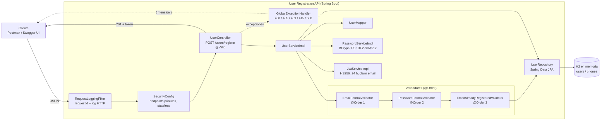
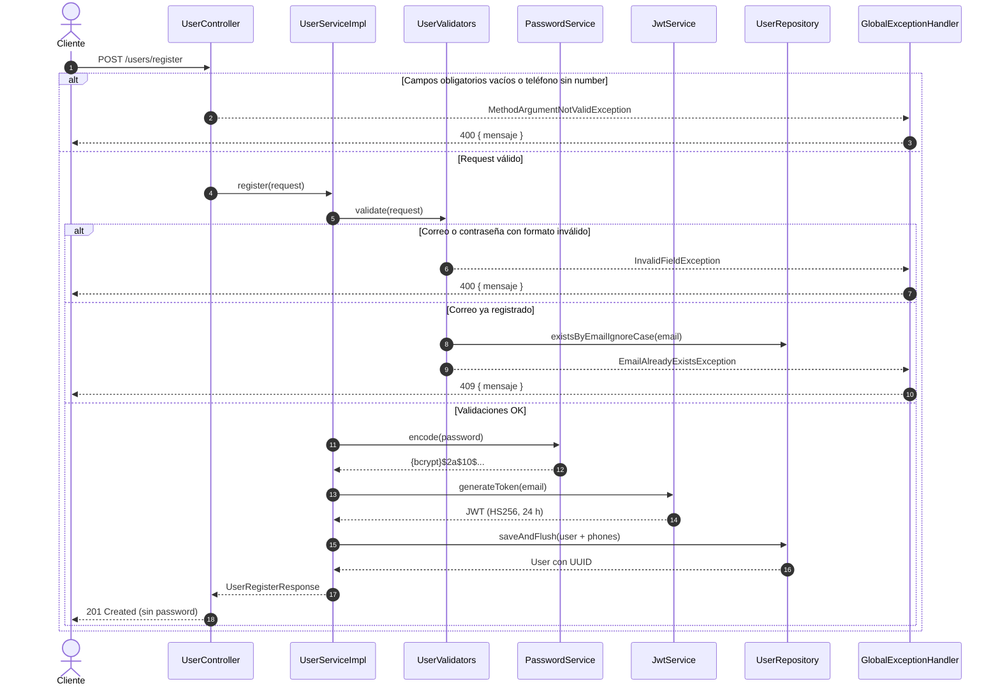
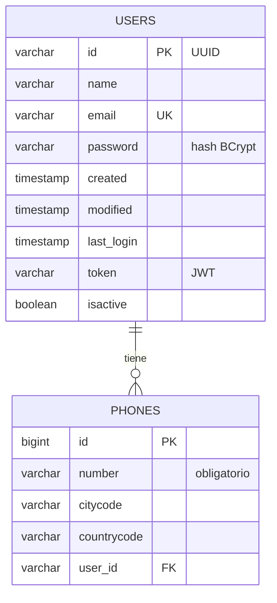

# BCI Integration - User Registration API

API REST para registro de usuarios con generación de token JWT.

## Stack
- Java 11 / Spring Boot 2.7.16
- Spring Data JPA + H2 en memoria
- Spring Security (BCrypt / PBKDF2-HMAC-SHA512)
- java-jwt 4.4.0 (HS256)
- springdoc-openapi (Swagger UI)
- JUnit 5 + Mockito + MockMvc

## Ejecución

```bash
mvn clean install
mvn spring-boot:run
```

- API: http://localhost:8080
- Swagger UI: http://localhost:8080/swagger-ui.html
- H2 Console: http://localhost:8080/h2-console (JDBC URL `jdbc:h2:mem:bcidb`, usuario `sa`, sin password)

## Endpoint

### POST /users/register

Request:
```json
{
  "name": "Juan Rodriguez",
  "email": "juan@rodriguez.org",
  "password": "Hunter@2024",
  "phones": [
    {
      "number": "1234567",
      "citycode": "1",
      "countrycode": "57"
    }
  ]
}
```

Response `201 Created`:
```json
{
  "id": "b8f8155c-70d5-45b8-9618-c8f02fd4d1a0",
  "name": "Juan Rodriguez",
  "email": "juan@rodriguez.org",
  "phones": [{ "number": "1234567", "citycode": "1", "countrycode": "57" }],
  "created": "2026-10-12T14:23:56.938523",
  "modified": "2026-10-12T14:23:56.938523",
  "last_login": "2026-10-12T14:23:56.938523",
  "token": "eyJhbGciOiJIUzI1NiIsInR5cCI6IkpXVCJ9...",
  "isactive": true
}
```

Errores, siempre con el formato `{"mensaje": "..."}`:

| Status | Caso |
|--------|------|
| 400 | Correo con formato inválido, contraseña fuera de formato, campos obligatorios vacíos, teléfono sin `number`, JSON mal formado |
| 409 | Correo ya registrado |
| 500 | Error no controlado |

## Configuración

`src/main/resources/application.properties`:

| Propiedad | Descripción |
|-----------|-------------|
| `validation.email-regex` | Formato del correo |
| `validation.password-regex` | Formato de la contraseña (mínimo 8 caracteres, una mayúscula, un número y un carácter especial `@#$%^&+=`) |
| `password.algorithm` | Algoritmo de hash de la contraseña: `BCRYPT` (por defecto) o `SHA512` (PBKDF2WithHmacSHA512) |
| `password.iterations` / `password.salt-length` | Iteraciones (210000) y largo del salt en bytes (16) para SHA512 |
| `jwt.secret` | Secreto HS256, se puede sobrescribir con la variable `JWT_SECRET` |
| `jwt.expiration-ms` | Vigencia del token (24 h) |

## Contraseñas

La contraseña se guarda con **BCrypt** (salt aleatorio incluido en el hash, factor de costo 10). El hash se almacena con el prefijo del algoritmo (`{bcrypt}$2a$10$...`), lo que permite cambiar `password.algorithm` a `SHA512` (PBKDF2WithHmacSHA512, 210.000 iteraciones) sin invalidar las contraseñas ya registradas.

## Logs

- Formato `action=..., clave=valor` en todas las capas (controller, service, validadores, JWT, advice).
- Cada request recibe un `requestId` (se toma del header `X-Request-Id` si viene, si no se genera) que aparece en cada línea de log y se devuelve en la respuesta.
- `RequestLoggingFilter` registra método, URI, status y duración de cada request.
- El correo se enmascara (`j***@rodriguez.org`); la contraseña y el token nunca se escriben en el log.
- Salida por consola y archivo rotativo en `logs/user-registration-api.log` (10 MB, 7 días).

```
INFO [requestId=7ff591a3-...] UserController   : action=registerUser, status=received, email=j***@rodriguez.org, phones=1
INFO [requestId=7ff591a3-...] UserServiceImpl  : action=registerUser, status=persisted, userId=51914eea-..., email=j***@rodriguez.org
INFO [requestId=7ff591a3-...] RequestLoggingFilter : action=httpRequest, method=POST, uri=/users/register, status=201, durationMs=296
```

## Diagrama de la solución

### Componentes



### Flujo de registro



### Modelo de datos



## Estructura

```
com.nisum.bci
├── config            SecurityConfig, OpenApiSwaggerConfig, RequestLoggingFilter, *Properties
├── constants         Constants, PasswordAlgorithm
├── controller        UserController
│   └── advice        GlobalExceptionHandler
├── dto               UserRegisterRequest, UserRegisterResponse, PhoneDTO, ErrorResponse
├── entity            User, Phone
├── exception         BciException, EmailAlreadyExistsException, InvalidFieldException
├── mapper            EntityMapper, UserMapper
├── repository        UserRepository, PhoneRepository
├── util              MaskingUtils
├── service           UserService, JwtService, PasswordService
│   └── impl          UserServiceImpl, JwtServiceImpl, PasswordServiceImpl
└── validator         UserValidator, EmailFormatValidator, PasswordFormatValidator, EmailAlreadyRegisteredValidator
```

## Patrones de diseño

- **Strategy + Chain of Responsibility**: cada regla de negocio implementa `UserValidator`. Spring inyecta la lista ordenada con `@Order` y `UserServiceImpl` la recorre antes de persistir. Agregar una regla nueva no requiere modificar el servicio.
- **Strategy (hash de contraseña)**: `DelegatingPasswordEncoder` elige la implementación (`bcrypt` o `pbkdf2-sha512`) según `password.algorithm`.
- **Mapper**: `UserMapper` (implementa `EntityMapper<D, E>`) concentra la conversión entre DTO y entidad.
- **Builder**: construcción de entidades y DTOs con Lombok `@Builder`.
- **Repository**: acceso a datos con Spring Data JPA.
- **Singleton (implícito, gestionado por Spring)**: los beans (`@Service`, `@Component`, `@Configuration`) tienen scope singleton por defecto, así que existe una sola instancia de cada servicio y validador. Los objetos costosos se crean una vez y se reutilizan: el `Algorithm` y el `JWTVerifier` en `JwtServiceImpl` y el `Pattern` de cada validador. No se usa el Singleton clásico (`getInstance()`) porque acopla el código y dificulta los tests.
- **Filter**: `RequestLoggingFilter` agrega trazabilidad por request sin tocar la lógica de negocio.

## Postman

Importar `postman/BCI-User-Registration.postman_collection.json`. La variable `baseUrl` apunta a `http://localhost:8080`.
Incluye el registro exitoso y los casos 409, 400, 415 y 405, cada uno con sus tests. Ejecutarla en orden desde el Collection Runner: el primer request genera un correo único que reutiliza el caso de correo duplicado.

## Tests

```bash
mvn test
```

- `UserServiceImplTest`, `JwtServiceImplTest`, `PasswordServiceImplTest`, `*ValidatorTest`, `MaskingUtilsTest`: pruebas unitarias.
- `GlobalExceptionHandlerTest`: MockMvc standalone con `UserService` mockeado; cubre cada handler del advice (409, 400, 415, 405 y 500).
- `UserControllerTest`: pruebas de integración con MockMvc y H2 (201, 409, 400, hash BCrypt persistido y header `X-Request-Id`).
